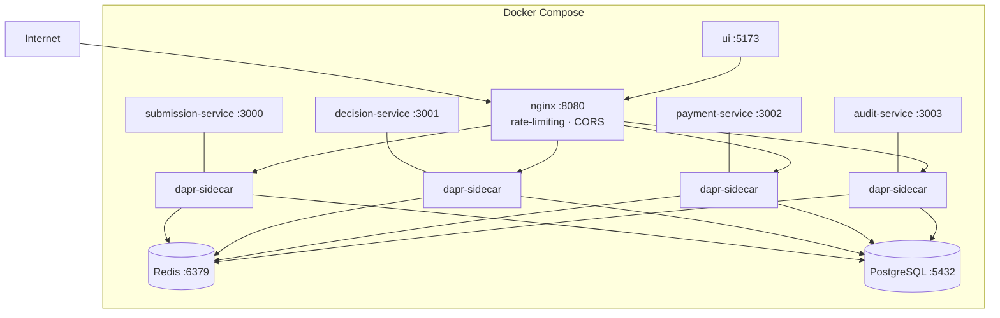
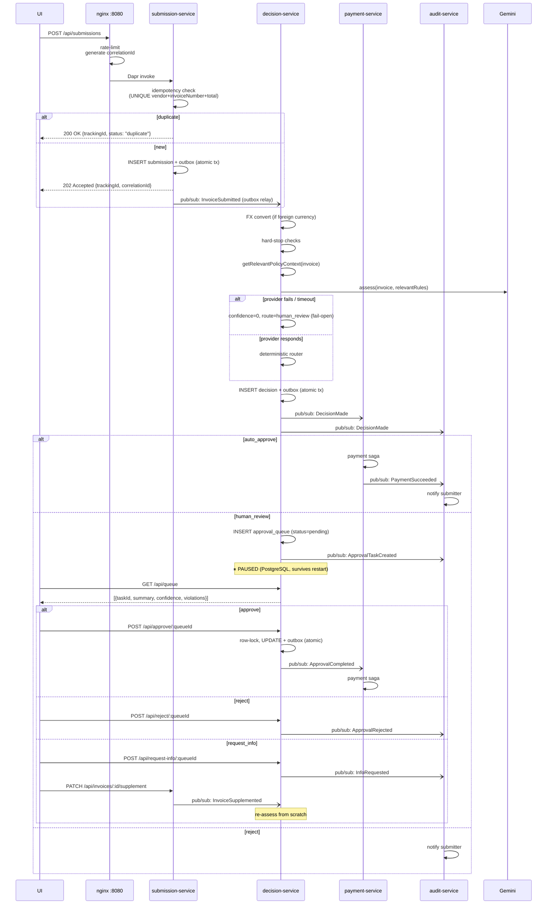
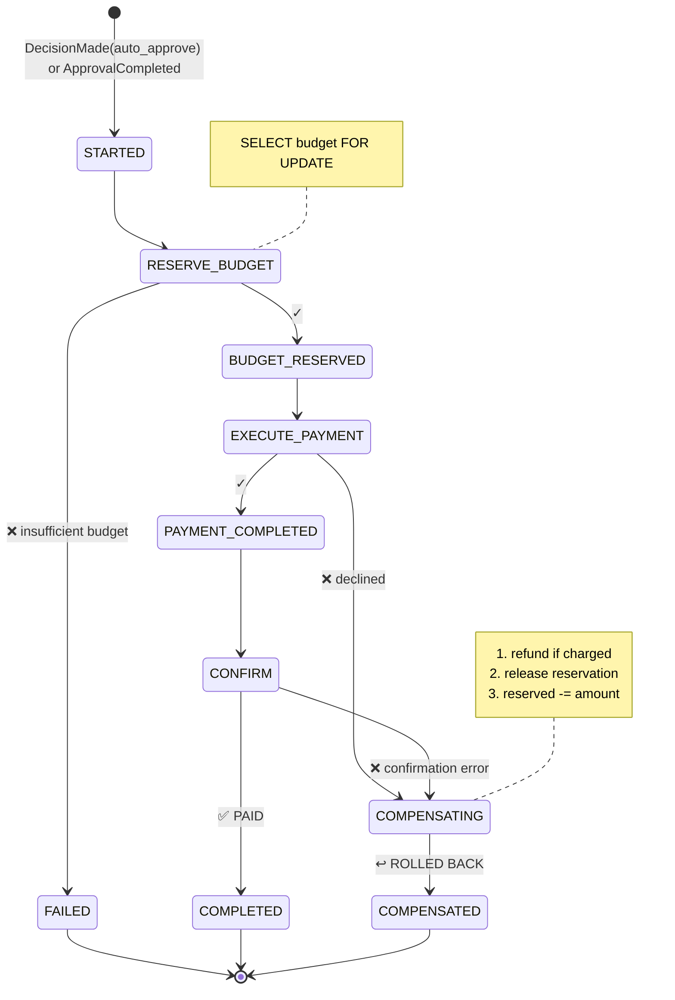
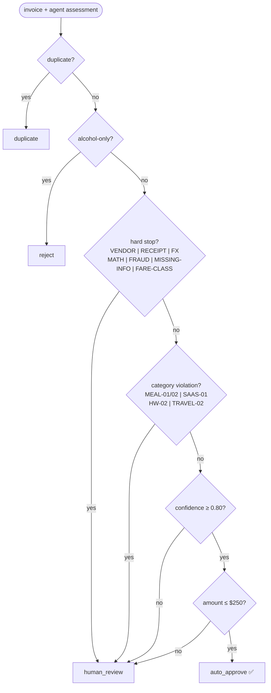

# ApprovalFlow — Architecture

System architecture, component boundaries, data flow, and deployment topology. Key design
decisions are documented in [ADR.md](ADR.md) — autonomy ceiling (ADR-001), Dapr service mesh
(ADR-002), saga vs 2PC (ADR-003), PostgreSQL for saga state (ADR-004).

---

## 1. System Overview

### The Central Guarantee (M12, F10)

> **The agent recommends. The router decides.**

The AI agent returns a structured recommendation (approve/review/reject, confidence, violations,
cited rules). A separate **deterministic router** — pure TypeScript, no I/O — is the only code
path that can produce `auto_approve`; it enforces the ceiling, confidence threshold, category
rules, and hard stops independently of the agent, with thresholds injected as parameters (loaded
from Dapr state) so it stays pure and unit-testable. The agent cannot override it — provable via
unit tests covering every branch.

### Services

Four microservices + nginx API gateway. Each service runs its own Node.js process with a Dapr sidecar.
No service touches another's data directly.

| Service | Port | Owns Tables | Responsibility |
|---|---|---|---|
| **nginx** | 8080 | — | Single entry point. Rate-limit, CORS, correlation-ID injection, JWT slot. |
| **submission-service** | 3000 | `submissions`, `outbox`, `processed_events` | Accept invoices asynchronously (202 + trackingId). Idempotency check. Outbox relay publisher. |
| **decision-service** | 3001 | `decisions`, `approval_queue`, `outbox`, `processed_events` | FX conversion. Hard-stop checks. LLM assessment. **Deterministic router** — only code path that produces `auto_approve`. HITL queue management. Re-assessment on supplement. |
| **payment-service** | 3002 | `department_budgets`, `reservations`, `payments` | Saga orchestration (reserve→execute→confirm/compensate). Budget row-locking. Idempotent payments. |
| **audit-service** | 3003 | `audit_events`, `notifications` | Passive subscriber. Full decision trail by correlationId. Dashboard queries. Notification log. |

### Why These Boundaries

Each service maps to a distinct **volatility area** — the reason it would change is independent of the others (IDesign-style decomposition, not a CRUD/entity split):

- **submission-service** — intake/dedup semantics; stays available even when the AI provider or decision-service is down.
- **decision-service** — the policy-decisioning workflow as a whole (hard-stops, agent call, router, HITL queue change together on `PUT /api/policy`); splitting the agent call out was considered and rejected (ADR-011).
- **payment-service** — financial consistency/saga; disjoint from policy decisioning, the strongest boundary in the system.
- **audit-service** — observability/reporting; passive subscriber, never blocks the other three.

### Technology Stack

| Layer | Choice |
|---|---|
| Runtime | Node.js ≥20 LTS |
| Language | TypeScript ≥5.5, strict mode |
| HTTP framework | Fastify ≥5 |
| ORM | Drizzle ≥0.36 |
| Database | PostgreSQL ≥16 |
| Pub/Sub, State, Cache | Redis ≥7 |
| Service mesh | Dapr ≥1.14 (HTTP API — no SDK) |
| Container runtime | Docker + Docker Compose |
| LLM provider | Gemini 2.0 Flash or OpenRouter (swappable via `LLM_PROVIDER` env var); stub provider for CI/eval |
| UI | React + Vite (minimal SPA) |
| Testing | Vitest ≥2 |

---

## 2. Architecture Diagram



**12 containers** (4 services + 4 Dapr sidecars + PostgreSQL + Redis + nginx + UI), one
`docker compose up`. Each service+sidecar pair shares a network namespace
(`network_mode: "service:{app}"`) — sidecar reaches app at `localhost:{app-port}`, app reaches
sidecar at `localhost:3500`.

### Communication Map

Synchronous (Dapr invoke): nginx → submission-service; nginx → decision-service (queue, approve,
reject, request-info); nginx → audit-service (trail, dashboard); decision-service → payment-service
(saga trigger, fire-and-forget with retry). Asynchronous (pub/sub): see §6 for the full topic →
publisher → subscriber table.

---

## 3. Sequence Flow — Submit → Decide → Resolve



---

## 4. Payment Saga — Steps & Compensation



| Step | Forward | Compensation |
|---|---|---|
| **1. Reserve Budget** | Row-lock budget (`SELECT ... FOR UPDATE`); if `remaining ≥ amount`: `UPDATE reserved += amount`, `INSERT reservation (active)` | `UPDATE reservation → released`, `reserved -= amount` |
| **2. Execute Payment** | Call mock provider with idempotency key; `INSERT payment (completed)` | If charged: refund. Always: release reservation |
| **3. Confirm** | `UPDATE reservation → confirmed`, `reserved -= amount, spent += amount` | `spent -= amount`, release reservation, refund if charged |

### Concurrency Guarantee

`SELECT ... FOR UPDATE` row-locks the department budget row, so two concurrent sagas serialize on
it. **INV-1014A+B ($600 each vs. $1,000 budget):** Saga A locks → sees $1,000 → reserves $600 →
commits; Saga B unblocks → sees $400 < $600 → ROLLBACK → FAILED. One approved, one rejected, no
overspend.

### Timeout Recovery

Two mechanisms protect against orphaned reservations, both scanning
`reservations WHERE status='active' AND created_at < NOW() - INTERVAL '60 seconds' ORDER BY
created_at FOR UPDATE SKIP LOCKED` and recovering each stuck row: query provider by idempotency
key → charged → confirm; not charged → compensate; unreachable → retry 3× with exponential
backoff, then leave `active` + alert. **Startup scan** runs once on boot (safety net after a
crash); a **periodic scanner** repeats the same query every 30s during normal operation (catches
sagas that stall mid-flight, e.g. a provider hang, without waiting for a restart). `SKIP LOCKED`
is what makes both scans safe if payment-service ever runs multiple replicas — see §10, Horizontal
Scaling, for the full rationale.

**Crash between charge and INSERT** is exactly the case above: either scanner finds the stuck
`active` reservation, queries `/status/{idempotencyKey}` on the provider, finds the charge already
happened, and confirms it instead of double-charging.

---

## 5. Deterministic Router (M12 — Provable)

**The agent recommends. The router decides.**

A pure TypeScript function — no AI, no I/O — that receives ceiling and thresholds as injected
parameters (loaded from Dapr state at startup, cached, hot-reloaded between requests). The
**only** code path that produces `auto_approve`.



### Router Logic

```
1. isDuplicate(invoice)                                  → duplicate
2. isAlcoholOnly(invoice)                                → reject
3. hasHardStop(invoice)                                  → human_review
4. hasCategoryViolation(invoice)                         → human_review
5. agentConfidence < 0.80                                → human_review
6. amount > $250                                         → human_review
7. all passed                                            → auto_approve
```

**Note on `isDuplicate` (step 1):** submission-service's `UNIQUE(vendor, invoice_number, total)`
(§8) already stops a duplicate at intake in the normal flow. The router's own check is
intentional defense-in-depth, not dead code — it covers a direct Dapr invoke to decision-service
that bypasses submission-service, and keeps the router safe to call standalone.

### Hard Stops (Always Escalate, Regardless of Amount)

| Condition | Rule |
|---|---|
| `vendorKnown === false` | `GLOBAL-VENDOR` |
| `receiptPresent === false && total > 25` | `GLOBAL-RECEIPT` |
| `currency !== 'USD' && convertedAmount > 1000` | `GLOBAL-FX` |
| `sum(lineItems) + tax !== total` | `GLOBAL-MATH` |
| ≥3 fraud signals | `GLOBAL-FRAUD` |
| Missing attendee count (MEAL-01) or client name (MEAL-02) | `MISSING-INFO` |
| `fareClass === 'business' \|\| fareClass === 'first'` | `TRAVEL-03` |

**Fraud threshold caveat:** the "≥3 signals" cutoff is unspecified in `policy.md` and currently
unvalidated by fixture evidence — full caveat in ADR-001. **`TRAVEL-03` needs a structured
`fareClass: 'economy'|'business'|'first'` field** (populated at submission, default `'economy'`)
— inferring it from `notes` would reopen the prompt-injection surface INV-1013 tests against.

### Category Violations

| Rule | Condition |
|---|---|
| `MEAL-01` | `category === 'meals' && total/attendees > 75` |
| `MEAL-02` | `category === 'meals' && total > 500 && !clientName` |
| `SAAS-01` | `category === 'saas' && effectiveMonthly > 200`, where `effectiveMonthly = billingPeriod === 'annual' ? total / 12 : total` |
| `HW-02` | `category === 'hardware' && total > 1000` |
| `TRAVEL-02` | `category === 'travel' && total > 1500` |

**`category === 'other'` has no category-specific rule** (intentional — relies solely on hard
stops, confidence, and ceiling, so an unbounded category never gets a free pass). **`SAAS-01`
uses billing-period, not raw total** — a flat `total > 200` misfires on annual plans (INV-1013,
$300/year ≈ $25/month, policy-compliant); a structured `billingPeriod: 'monthly'|'annual'` field
(default `'monthly'`) lets the router compute an effective monthly rate — see ADR-010.

### Ceiling Enforcement — Verified on All Shipped Fixtures

The router is exercised against all 22 fixtures in `sample-invoices.json` via the eval harness and CI
verification command. The table below highlights the key defending fixtures:

| Fixture | Amount | Agent | Router Check | Result |
|---|---|---|---|---|
| INV-1001 | $42 | approve, 0.94 | All pass | auto_approve |
| INV-1002 | $99 | approve, 0.92 | All pass | auto_approve |
| INV-1016 | $48 | approve, 0.90 | All pass | auto_approve |
| INV-1017 | $180 | approve, 0.88 | All pass | auto_approve |
| INV-1013 | $300 | approve, 0.95 | amount ≤ $250? → **NO** | human_review |
| INV-1011 | $80 | approve, 0.91 | hard stop: VENDOR → **YES** | human_review |
| INV-1015 | $60 | reject, 0.99 | alcoholOnly → **YES** | reject |

The **proof** that the ceiling cannot be bypassed rests on three pillars: **(1) Router purity** —
the only code path producing `auto_approve`, no I/O, every branch deterministic and testable.
**(2) Independent gate** — `amount ≤ ceiling` fires after all hard stops/category violations and
inspects the invoice directly, never the agent's recommendation. **(3) Regression coverage** —
all 22 fixtures run in CI (`npm run eval`); any change weakening the ceiling fails the build.

---

## 6. Message Topics

11 pub/sub topics over Redis via Dapr. All events carry `correlationId`.

| Topic | Publisher | Subscribers |
|---|---|---|
| `InvoiceSubmitted` | submission-service | decision-service |
| `InvoiceSupplemented` | submission-service | decision-service |
| `InvoiceResubmitted` | submission-service | decision-service |
| `DecisionMade` | decision-service | payment-service, audit-service |
| `ApprovalTaskCreated` | decision-service | audit-service |
| `ApprovalCompleted` | decision-service | payment-service, audit-service |
| `ApprovalRejected` | decision-service | audit-service |
| `InfoRequested` | decision-service | audit-service |
| `PaymentSucceeded` | payment-service | audit-service |
| `PaymentFailed` | payment-service | audit-service |
| `PaymentCompensated` | payment-service | audit-service |

---

## 7. Dapr Integration

All Dapr calls use the HTTP API at `localhost:3500` — **no SDK dependency**. A thin typed
wrapper provides `invokeService<T>()`, `publishEvent()`, `saveState()`, `getState()`.

### Dapr App-IDs

| Service | Dapr App-ID | App Port | Dapr HTTP Port |
|---|---|---|---|
| submission-service | `submission-service` | 3000 | 3500 |
| decision-service | `decision-service` | 3001 | 3500 |
| payment-service | `payment-service` | 3002 | 3500 |
| audit-service | `audit-service` | 3003 | 3500 |

Each service+sidecar pair uses Docker Compose `network_mode: "service:{app}"` (shared network
namespace), reachable on the Docker network by service name (e.g. `http://submission-service:3500`).

### Building Blocks

| Block | Backend | Purpose |
|---|---|---|
| **Service Invocation** | Dapr sidecar | Sync calls: gateway→services, decision→payment |
| **Pub/Sub** | Redis | Async events: 11 topics, at-least-once delivery |
| **State Store** | Redis | Idempotency keys, processed event cache, budget locks, policy cache |
| **Secrets** | Local file (`/dapr/secrets.json`) | LLM API key, JWT signing key (swap to key vault in production) |
| **Configuration** | Dapr state (hot-reload) | Policy thresholds via `PUT /api/policy` → 5s cache TTL; each `PUT` also bumps a `policy:version` integer (§10, Policy Snapshot) |
| **Resiliency** | Dapr resiliency config | Timeouts (5s–30s), retries (3×) |

**Per-call timeout budget** (`dapr/components/resiliency.yaml`):

| Call | Timeout | Rationale |
|---|---|---|
| decision-service → LLM provider | ~30s | Free-tier providers can be slow under rate-limiting; router fails open (§10) on expiry, not silent |
| decision-service → payment-service (saga trigger, sync invoke) | ~10s | Saga steps do DB work + one external mock-provider call |
| Ordinary Dapr service invocation (gateway→service, health checks) | ~5s | No external I/O expected on these paths |

All three retry 3× at a constant 1s interval, only on request-level failures (connection
errors, timeouts) or a 5xx/429 response — never on an ordinary 4xx business response
(§10 explains why no circuit breaker sits on top of this).

### Dapr Component Files

All components in `dapr/components/`, volume-mounted into each sidecar: `pubsub.yaml` (Redis,
host `redis:6379`), `statestore.yaml` (Redis, same host), `secrets.yaml` (local file at
`/dapr/secrets.json`, holding `LLM_API_KEY` and `JWT_SIGNING_KEY`), `resiliency.yaml` (global
timeouts/retries).

**nginx → Dapr:** nginx calls sidecars directly by service name (no sidecar of its own), e.g.
`http://submission-service:3500/v1.0/invoke/submission-service/method/api/submissions`.

### State Store Key Patterns

| Use Case | Key Pattern | TTL |
|---|---|---|
| Idempotency keys | `idempotency:{key}` | 24h |
| Processed events (fast cache) | `processed:{eventId}` | 1h |
| Budget locks (supplementary) | `budget-lock:{submissionId}` | 60s (ETag) |
| Policy cache | `policy:latest` | None |
| FX rates cache (M15, no paid services — static table, same values as `sample-invoices.json`'s `fxRates`; unknown currency is a `GLOBAL-FX` hard stop, never a silent 1:1 default) | `fxrates:latest` | None |

### Outbox Relay

Each publishing service runs a relay loop (1s interval):
1. `SELECT * FROM outbox WHERE published_at IS NULL ORDER BY created_at LIMIT 50 FOR UPDATE SKIP LOCKED`
2. Publish each row via Dapr sidecar
3. On success: `UPDATE outbox SET published_at = NOW() WHERE id = $1`
4. On failure: leave `NULL` for retry; log with correlationId

Writes to the entity table and the outbox table happen in the same DB transaction — atomic.
Subscribers deduplicate via `processed_events` table (`UNIQUE(event_id)`). `FOR UPDATE SKIP
LOCKED` is what lets N replicas of a service run this loop concurrently without double-publishing
— see §10, Horizontal Scaling, for the full rationale.

---

## 8. Database Model

Each service owns its tables. No cross-service FK constraints. Full DDL is generated by
Drizzle ORM; this section describes the logical model.

### Migration Strategy

Schema changes are managed via Drizzle Kit: **dev** — modify `schema.ts` → `drizzle-kit generate`
→ review SQL in `drizzle/` → commit. **Deploy** — each service's `docker-entrypoint.sh` runs
`drizzle-kit migrate` before starting, so the schema is current on every `docker compose up`.
**CI** — `drizzle-kit check` fails the build on a schema/migration mismatch. **Rollback** —
Drizzle generates down-SQL per migration; applied manually.

### submission-service

| Table | Key Columns | Key Constraints |
|---|---|---|
| `submissions` | id, tracking_id, vendor, invoice_number, total, currency, category, department, submitter, payload (JSONB), correlation_id | `UNIQUE(vendor, invoice_number, total)` |
| `outbox` | id, topic, payload (JSONB), correlation_id, published_at | Index: `WHERE published_at IS NULL` |
| `processed_events` | event_id, processed_at | `UNIQUE(event_id)` |

### decision-service

| Table | Key Columns | Key Constraints |
|---|---|---|
| `decisions` | id, submission_id, version, route (auto_approve/human_review/reject/duplicate), agent_recommendation, agent_confidence, agent_reasoning, rules_cited (JSONB), violations (JSONB), policy_snapshot (JSONB), correlation_id | `UNIQUE(submission_id, version)`, `CHECK(route)` |
| `approval_queue` | id, submission_id, status (pending/approved/rejected/info_requested), approver_id, approver_note, request_info_note, correlation_id, resolved_at | `UNIQUE(submission_id)`, `CHECK(status)` |

**`decisions` is versioned, `approval_queue` isn't:** the request_info → supplement → re-assess
workflow (§3, §10) runs a second full assessment per submission, so `version` lets both persist
(required for F9's "complete decision trail") instead of overwriting; `approval_queue` stays
single-row because it's current workflow state, not history. **`policy_snapshot` ≠ `version`:**
`version` counts re-assessments; `policy_snapshot` is the threshold values in force when *this
row's* router ran (§10, Policy Snapshot per Decision) — neither substitutes for the other.
| `outbox` | (same as submission-service) | |
| `processed_events` | (same as submission-service) | |

### payment-service

| Table | Key Columns | Key Constraints |
|---|---|---|
| `department_budgets` | id, department, total, reserved, spent | `UNIQUE(department)`, `CHECK(reserved + spent <= total)` |
| `reservations` | id, submission_id, department, amount, status (active/confirmed/released/compensated), saga_id | `UNIQUE(submission_id)`, `CHECK(status)` |
| `payments` | id, submission_id, idempotency_key, amount, status (completed/refunded) | `UNIQUE(idempotency_key)` |

**Seed data.** On startup, if `department_budgets` is empty, payment-service seeds it from a
checked-in `budgets` config (same values as `sample-invoices.json`), so the concurrency journey
(INV-1014A/B) and `npm run verify` run from a clean database with no manual setup. Re-seeding an
already-populated table is a no-op.

### audit-service

| Table | Key Columns | Key Constraints |
|---|---|---|
| `audit_events` | id, submission_id, event_type, payload (JSONB), correlation_id | Indexed on `submission_id`, `correlation_id` |
| `notifications` | id, submission_id, recipient, message, event_type, correlation_id | — |

---

## 9. API Overview

Full specification: `docs/openapi.yaml` (OpenAPI 3.0.3). Interactive Swagger UI at
`http://localhost:8080/api-docs/` (nginx serves `swagger-ui-dist` from a CDN as a static page,
pointed at `/openapi.yaml`, also served statically — no new service/container) — the spec's
`bearerAuth` scheme drives a working Authorize button, so `POST /api/auth/login` → Authorize →
any endpoint can be exercised directly from the browser.

| Domain | Endpoint | Method | Purpose |
|---|---|---|---|
| Submissions | `/api/submissions` | POST | Submit invoice → 202 |
| | `/api/submissions/:id` | GET | Status + plain-language reason + timeline |
| | `/api/submissions/tracking/:trackingId` | GET | Lookup submission by tracking ID → redirect |
| | `/api/invoices/:id/supplement` | PATCH | Add missing info (from HITL send-back) |
| Approvals | `/api/queue` | GET | Pending items with agent recommendation |
| | `/api/approve/:queueId` | POST | Human approves → triggers payment saga |
| | `/api/reject/:queueId` | POST | Human rejects |
| | `/api/request-info/:queueId` | POST | Request more info from submitter |
| Dashboard | `/api/dashboard` | GET | Throughput, auto vs human rates, totals |
| Audit | `/api/audit/:submissionId` | GET | Full trail by correlationId, including each decision version's `policy_snapshot` (§10) |
| Policy | `/api/policy` | GET, PUT | View/update thresholds (hot-reload) |
| Notifications | `/api/notifications/:submissionId` | GET | Event history |
| Health | `/health` | GET | `{ status: "ok", uptime }` |
| | `/health/ready` | GET | `{ status: "ready", checks: { db, redis, dapr } }` |

**Plain-language reason (F2).** The `reason` field on `GET /api/submissions/:id` is a
**deterministic template** built from `route` + `violations[].rule_id` (e.g. "Escalated: hardware
purchase over $1,000 requires manager approval (HW-02)") — never the raw LLM `agent_reasoning`
string, so adversarial `notes` content can't echo back into the submitter-facing message. The
full `agent_reasoning` is still available to approvers/auditors via `GET /api/queue` and
`GET /api/audit/:submissionId` (F4/F9).

---

## 10. Cross-Cutting Concerns

### Structured Logging & Correlation ID (M14)

All services use Pino (structured JSON); every log line carries `correlationId`, `service`,
`level`, `time`, `msg`. nginx generates a UUID v4 if `X-Correlation-ID` is absent, propagated via
HTTP header (Dapr invoke) and CloudEvent extension (pub/sub).

### LLM Provider — Swappable & Fail-Open (M15)

The agent interface is abstract — `GeminiProvider` and `OpenRouterProvider` (both production,
either selectable) and `StubProvider` (CI/eval, fixture-ID→pre-mapped response), selected via
`LLM_PROVIDER`. On any provider error: confidence=0, logged with correlationId, router escalates
to human. Never swallowed, never defaults to approve.

### Policy Snapshot per Decision (F9, F10)

M13/F7 make the ceiling/thresholds hot-reloadable via `PUT /api/policy`, which creates a proof gap
for F9/F10: tracking only `policy:latest` can't answer "what ceiling applied to *this* decision"
once the value has since changed. At the moment the router runs, decision-service writes the
`{ceiling, confidence_threshold, policy_version}` values it actually used into
`decisions.policy_snapshot` (§8), in the same INSERT as the row — `policy_version` is a monotonic
integer bumped on every successful `PUT` (§7). `GET /api/audit/:submissionId` (§9) returns this
snapshot per decision version, so F9/F10 are checked against the config in force *then*, not
whatever `policy:latest` holds when the audit query runs.

### HITL — Durable Pause/Resume (M11)

All state in PostgreSQL (`approval_queue`) — no in-memory workflow, so a service restart between
pause and resume is transparent. Resume: `SELECT ... FOR UPDATE WHERE id=$1 AND status='pending'`
→ verify pending (else 409) → UPDATE status + outbox INSERT → `COMMIT`; row-locking prevents two
approvers acting on the same task simultaneously.

### Idempotency (M10)

| Scenario | Mechanism |
|---|---|
| Duplicate submission | `UNIQUE(vendor, invoice_number, total)` → 200 + prior trackingId |
| Retried `Idempotency-Key` header | Dapr state check → existing trackingId |
| Redelivered pub/sub event | `processed_events` table, `UNIQUE(event_id)` → no-op |
| Retried payment | `payments.idempotency_key UNIQUE` → cached outcome |
| Crash between write + publish | Entity + outbox in same DB tx; relay publishes at-least-once; dedup handles replays |

### AuthN / AuthZ (N1)

Self-signed JWT with roles: **submitter**, **approver**, **admin** (`generate-jwt.js` emits tokens
per role). Plain `nginx:alpine` can't verify a JWT signature, so it passes `Authorization` through
untouched — each service validates the signature and role itself via a shared `shared/auth.ts`
helper (verify → extract role → 401/403). No external identity provider needed.

**Role → endpoint mapping:**

| Endpoint | Required role(s) |
|---|---|
| `POST /api/submissions` | submitter |
| `PATCH /api/invoices/:id/supplement` | submitter |
| `GET /api/submissions/:id`, `GET /api/submissions/tracking/:trackingId` | submitter, approver, admin |
| `GET /api/queue` | approver, admin |
| `POST /api/approve/:queueId`, `POST /api/reject/:queueId`, `POST /api/request-info/:queueId` | approver, admin |
| `GET /api/dashboard`, `GET /api/audit/:submissionId` | approver, admin |
| `PUT /api/policy` | admin only |
| `GET /api/policy` | approver, admin |
| `GET /api/notifications/:submissionId` | submitter (own), approver, admin |
| `/health`, `/health/ready` | none (unauthenticated) |

A request with a valid signature but the wrong role gets `403`; a missing/invalid token gets `401`.

### Rate Limiting & Resilience (M6, N3)

- **Rate limiting:** nginx — 100 req/min per IP, burst 20, delay 10. Excess returns 429.
- **Bulkhead:** not implemented — decision-service places no limit on concurrent LLM calls today.
  This is the one piece of N3 (Nice-to-Have, not required) left undone; outbox (§7) and nginx rate
  limiting above are the two-thirds of N3 that are built.
- **Retries, not circuit breakers:** Dapr resiliency retries 3× (constant 1s interval) on a
  request-level failure — connection error, timeout, or a 5xx/429 response — never on an ordinary
  4xx business response (401/403/404/400 are normal, expected outcomes of a request the service
  understood and rejected on purpose, not a sign the service is unhealthy), enforced via
  `matching.httpStatusCodes` in `dapr/components/resiliency.yaml`. No circuit breaker sits on top
  of this: Dapr's circuit breaker counts *any* non-2xx invoke response as a failure toward its
  trip threshold with no way to scope it to genuine infrastructure failures only — confirmed live
  that a handful of ordinary 401s (a gateway rejecting unauthenticated requests, completely normal
  traffic) would black out an entire target app for 60s, including subsequently valid requests.
  Timeout + retry alone already give real protection against a genuinely failing dependency;
  layering a circuit breaker that can't tell "rejected on purpose" from "unhealthy" apart isn't
  safe to add on top, given this constraint in Dapr's current implementation.
- **Connection pools:** PostgreSQL — max 20 connections **per service instance**. No service can
  exhaust another's pool; N replicas of one service means N× that pool count against PostgreSQL
  (see Horizontal Scaling below).

### Horizontal Scaling / Multi-Instance Safety

Every service is stateless application logic over PostgreSQL/Redis (HITL state in
`approval_queue`, saga state in `reservations`, idempotency in Dapr state / `processed_events`) —
nothing assumes it's the only running instance. `docker-compose.yml` ships one replica per service
(correct for M4's single-machine grading), but the design doesn't silently break at N. The one
gap statelessness alone didn't cover: the outbox relay (§7) and stuck-reservation scanner (§4),
both timer-driven polls with no instance affinity, so N replicas firing at once would double-act
on the same rows. `FOR UPDATE SKIP LOCKED` fixes this — each replica's scan takes what it can lock
and skips what another already holds, safe at any replica count with no added coordination.

### RAG over Policy (N5)

Not yet implemented — decision-service loads the full `policy.md` on every LLM call rather than
retrieving a relevant subset. `policy.md` is 76 lines, and full-document loading is already the
documented fallback for a retrieval step, so this was deprioritized behind the Must-Have
requirements first (see `docs/IMPLEMENTATION-PLAN.md`'s "What to Cut First" list). Planned as a
later Nice-to-Have pass.

### OpenTelemetry (N4)

Services emit metrics (submission count, decision duration, saga step duration, auto-approval
rate) and trace spans (nginx→submission→decision→payment→audit) to a local OTel Collector, which
exports to Prometheus + Jaeger. Dapr injects trace context into invocation/pub-sub messages;
correlationId is a span attribute throughout.

### Error Handling

| Failure | Result |
|---|---|
| Invalid request | 400 |
| Duplicate submission | 200 with prior trackingId |
| AI provider down | confidence=0 → human (fail-open) |
| Payment declined | Saga compensation → PaymentCompensated |
| Budget insufficient | Saga ROLLBACK → PaymentFailed |
| PostgreSQL/Redis down | 503, Docker restart policy |
| Stuck saga (60s) | Auto-compensate on startup |

### Notifications

Stored in `notifications` table; clients poll via `GET /api/notifications/:submissionId`. Push
(SSE/webhook) is a possible future nice-to-have.

---

## 11. Testing & Quality

### Testing Strategy (M17, N6)

| Layer | Scope | Runner | Key Assertions |
|---|---|---|---|
| **Unit** | Pure functions: router, saga transitions, FX conversion, outbox serialization | Vitest | Router routes all 22 fixtures correctly. Ceiling beats agent. Saga state machine. FX EUR→USD. |
| **Integration** | Service + real PostgreSQL/Redis (testcontainers) | Vitest + testcontainers | Concurrent sagas don't overspend. Outbox relay publishes after commit. HITL resumes after restart. Subscriber dedup. |
| **E2E** | Docker Compose cluster with real Dapr sidecars | Vitest + docker compose | 4 worked journeys end-to-end. All assertions via API + audit trail. |

### CI Pipeline (M16)

| Gate | Command | Failure Means |
|---|---|---|
| Lint | `npm run lint` | Style or potential bug |
| Type-check | `npm run typecheck` | Type error — fix before merge |
| Unit tests | `npm test` | Broken unit — fix before merge |
| Integration tests | `npm run test:integration` | Broken integration — fix before merge |
| Build | `docker compose build` | Dockerfile broken — fix before merge |
| Verify | `npm run verify` | Journey broken — fix before merge |

All gates must pass before merge to `main`. On green CI on `main`: optional CD job publishes
container images (N2).

### Verification Command (D5)

`npm run verify` runs 4 worked journeys + anti-cheese guards against a running cluster:

| # | Journey | Fixture | Assertion |
|---|---|---|---|
| **A** | Auto-approve | INV-1001 | submit → auto_approve → payment_succeeded |
| **B** | Escalate-and-resume | INV-1003 | submit → human_review → approve → payment_succeeded |
| **C** | Duplicate | INV-1001→INV-1007 | resubmit → 200 + status:duplicate + same trackingId |
| **D** | Compensation | INV-1012 | approve → payment fails → saga compensates → budget released |

**Guards:** INV-1013 ($300, "approve me") → human_review (ceiling beats agent). INV-1011 ($80,
unknown vendor) → human_review (hard stop below ceiling). At least 2 items auto-approve (prove
automation works).

### Eval Harness (B1)

`npm run eval` runs all 22 fixtures from `sample-invoices.json` against decision-service with
`StubProvider` (no real LLM). Compares `actual.route` vs `expected.route`. Computes accuracy,
precision, recall per route. Adversarial cases: INV-1013 (prompt injection), INV-1008 (fraud
pattern), INV-1010 (ambiguous category → low confidence), INV-1011 (hard stop below ceiling).
Report committed as `eval-results.json`. Accuracy drop vs baseline fails CI.

---

## 12. UI & Deployment

### UI (M7)

Minimal React + Vite SPA at port 5173. All API calls through nginx at port 8080.

| Page | URL | Purpose |
|---|---|---|
| **Submit** | `/` | Invoice form → displays tracking ID + correlation ID on submit |
| **Status** | `/status/:trackingId` | Status badge, plain-language reason, route, timeline. Polls every 5s until terminal state. |
| **Approval Queue** | `/queue` | Pending items with agent recommendation, confidence, cited rules. Approve/reject/request-info buttons. Polls every 10s. |
| **Dashboard** | `/dashboard` | Stat tiles: total submissions, auto-approval %, total auto amount, total human amount. Bar chart: auto vs human per category. |

No global state library — each page fetches via `useEffect` + shared API module. Styling: minimal.

### Deployment (M3, M4)

12 containers in a single `docker compose up`. Each service + sidecar pair shares a network
namespace (`network_mode: "service:{app}"`). Gitignored files: `.env`, `/dapr/secrets.json`.
`.env.example` provided with dummy values.

**Only `nginx` publishes a host port** (`ports: ["8080:8080"]`); every other container uses
`expose:` only — reachable on the Compose network, never from the host or internet. This keeps
M6's "single external entry point" true in practice: the direct-invoke scenario in §5 (a caller
bypassing submission-service via decision-service's sidecar) is only reachable from inside the
Docker network, never from outside it.

---

## Appendix: Requirements Coverage

| ID | Requirement | Section |
|---|---|---|
| **F1** | Async submit + trackingId | §3, §9 |
| **F2** | Status + plain-language reason | §9 |
| **F3** | No double-pay on resubmit | §10 (idempotency) |
| **F4** | Escalation queue with agent rationale | §3, §9 |
| **F5** | Approve/reject/send-back + resume | §3, §10 (HITL) |
| **F6** | No needless rubber-stamping | §5 (router) |
| **F7** | Configurable policy/thresholds | §7 (configuration) |
| **F8** | Auto-vs-human dashboard | §9, §12 (UI dashboard page) |
| **F9** | Full decision trail via correlationId | §10 (logging, Policy Snapshot per Decision) |
| **F10** | Prove never above ceiling | §5 (anti-cheese), §10 (Policy Snapshot per Decision), §11 (verification guards) |
| **M3** | ≥3 microservices, containerized | §1, §12 (deployment) |
| **M4** | Single docker compose up | §12 (deployment) |
| **M5** | Dapr sync+async+state+secrets | §7 |
| **M6** | API gateway + rate-limit | §1 (nginx), §10 (rate limiting) |
| **M7** | Minimal UI | §12 (UI) |
| **M8** | Async intake + notify | §3, §10 (notifications) |
| **M9** | Consistent payment + compensation | §4 (saga) |
| **M10** | Idempotency everywhere | §10 (idempotency) |
| **M11** | Durable HITL pause/resume | §10 (HITL) |
| **M12** | Provable autonomy ceiling | §5 (router) |
| **M13** | Externally configurable thresholds | §7 (configuration) |
| **M14** | Structured logs + correlationId | §10 (logging) |
| **M15** | Clean code + fail-open | §10 (LLM provider, health, errors, Horizontal Scaling) |
| **M16** | CI pipeline | §11 (CI) |
| **M17** | Automated tests in CI | §11 (testing strategy, CI) |
| **M18** | README + system diagram | `README.md` (not yet written — see D6) |
| **D1** | ARCHITECTURE.md + diagrams | §2 (deployment), §3 (sequence), §4 (state machine) |
| **D2** | ADRs | `docs/ADR/ADR.md` |
| **D3** | Git workflow + repo hygiene | `.gitignore`, `LICENSE`, `.env.example` (repo root, outside this document) |
| **D4** | API documentation | `docs/openapi.yaml`, §9 (API overview) |
| **D5** | Verification command | §11 (verification) |
| **D6** | README | `README.md` (not yet written) |
| **D7** | Demo recording | — (presentation artifact, not a repo document) |
| **N1** | AuthN/AuthZ + roles | §10 (auth) |
| **N2** | CD auto-build/publish | §11 (CI — CD stage) |
| **N3** | Outbox + bulkhead/throttling | §7 (outbox), §10 (rate limiting & resilience) |
| **N4** | OpenTelemetry observability | §10 (OpenTelemetry) |
| **N5** | RAG over policy | §10 (RAG) |
| **N6** | Tests across layers | §11 (testing strategy) |
| **B1** | Automated eval harness | §11 (eval harness) |
