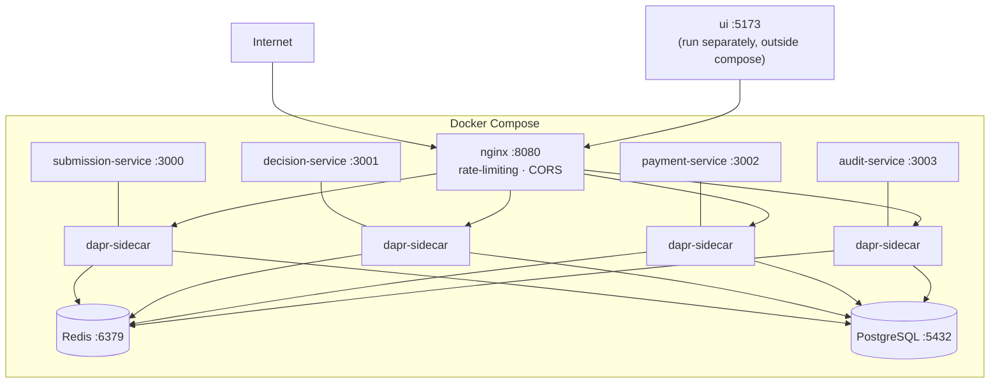

# ApprovalFlow — Invoice & Expense Approval Platform

A microservice-based, AI-assisted platform that automates invoice and expense approvals: an AI
agent assesses each submission against a configurable company policy, a deterministic router
auto-approves the low-risk majority within a provable ceiling, and escalates everything else to a
human approver. Every decision is fully auditable.

## Contents

- [Overview](#overview)
- [Architecture](#architecture)
- [Technologies used](#technologies-used)
- [Running locally](#running-locally)
- [Testing & verification](#testing--verification)
- [Documentation](#documentation)

## Overview

The core product tension: an autonomy ceiling of $0 is trivially "safe" but useless — every item
hits a human and nothing is automated. A ceiling matching the highest policy limit maximizes
automation but risks a single high-value item slipping through on a wrong AI call. ApprovalFlow
resolves this with **the agent recommends, the router decides**: the LLM produces a structured
recommendation (approve/review/reject, confidence, cited policy rules, violations), but a separate,
pure-TypeScript, unit-tested **deterministic router** is the only code path that can actually
produce `auto_approve`. It enforces a $250 autonomy ceiling, an 0.80 confidence floor, and a set of
hard stops (new vendor, currency mismatch, math mismatch, missing receipt, alcohol-only) that no
amount of AI confidence — or adversarial prompting in the invoice notes — can override. The full
reasoning behind the $250 figure, including a fixture-by-fixture walkthrough of why $100 and $500
were both rejected, is in [docs/PRODUCT-DILEMMA.md](docs/PRODUCT-DILEMMA.md).

Every submission produces a complete, replayable audit trail (correlation-id-linked events across
all four services), and money only moves through a saga (reserve → execute → confirm/compensate)
that fails safe: a payment failure after approval automatically reverses the budget reservation
rather than leaving it stuck.

## Architecture



Four microservices, each with its own Dapr sidecar and its own slice of the schema — no service
touches another's tables directly:

| Service                | Responsibility                                                                                |
| ---------------------- | --------------------------------------------------------------------------------------------- |
| **nginx**              | Single external entry point. Rate-limiting, CORS, correlation-id injection, JWT pass-through. |
| **submission-service** | Accepts invoices asynchronously, dedup (F3), outbox relay.                                    |
| **decision-service**   | LLM assessment + the deterministic router (only path to `auto_approve`), HITL approval queue. |
| **payment-service**    | Saga orchestration (reserve → execute → confirm/compensate), budget row-locking.              |
| **audit-service**      | Passive subscriber — full audit trail, dashboard stats, notification log.                     |

See [ARCHITECTURE.md](ARCHITECTURE.md) for the full system design, sequence diagrams, state
machines, and the payment saga/compensation flow in detail. Key decisions are recorded as ADRs
under [docs/ADR/ADR.md](docs/ADR/ADR.md) — notably the $250 autonomy ceiling (ADR-001), Dapr as the
service mesh (ADR-002), and saga over 2PC for payments (ADR-003).

## Technologies used

| Layer                 | Choice                                                                                                               |
| --------------------- | -------------------------------------------------------------------------------------------------------------------- |
| Runtime               | Node.js ≥20 LTS                                                                                                      |
| Language              | TypeScript ≥5.5, strict mode                                                                                         |
| HTTP framework        | Fastify ≥5                                                                                                           |
| ORM                   | Drizzle ≥0.36                                                                                                        |
| Database              | PostgreSQL ≥16                                                                                                       |
| Pub/Sub, state, cache | Redis ≥7                                                                                                             |
| Service mesh          | Dapr ≥1.14 (HTTP API, no SDK)                                                                                        |
| Gateway               | nginx                                                                                                                |
| Container runtime     | Docker + Docker Compose                                                                                              |
| LLM provider          | Gemini 2.0 Flash or OpenRouter (swappable via env var — see `.env.example`); deterministic stub provider for CI/eval |
| UI                    | React + Vite (minimal SPA)                                                                                           |
| Testing               | Vitest ≥2                                                                                                            |

## Running locally

From a fresh clone:

```bash
npm install
cp .env.example .env
cp dapr/secrets.json.example dapr/secrets.json   # fill in a real LLM_API_KEY only if LLM_PROVIDER≠stub
docker compose up
```

This starts all 4 services + their Dapr sidecars + PostgreSQL + Redis + nginx (12 containers).
The gateway is then live at `http://localhost:8080` (`GET /health` to confirm), and
`npm run verify` (below) is ready to run against it.

The UI runs separately, outside docker compose, talking to the gateway above:

```bash
npm run dev -w ui
```

Then open `http://localhost:5173`. The login screen mints a self-signed role token (name + role —
see [docs/ADR/ADR.md](docs/ADR/ADR.md) for why this project has no real identity provider) rather
than a real username/password.

## Testing & verification

```bash
npm test               # unit + integration tests, per service (vitest)
npm run lint            # eslint
npm run format          # prettier --check
npm run typecheck       # tsc across every workspace + scripts/

npm run verify           # one-command, end-to-end acceptance gate (D5) — requires the
                          # docker compose cluster above to be running; exercises Journeys
                          # A/B/C/D and the anti-cheese guards against the real gateway API
```

`npm run eval` (an automated eval harness over the fixture set, B1) is not yet built — it's Bonus,
not required — so it isn't listed above as a working command yet.

`npm run verify` is also what CI's `verify` job runs against a freshly built cluster on every
push/PR (`.github/workflows/ci.yml`) — it's the same acceptance bar locally and in CI, not a
separate "trust me" check.

## Documentation

- [ARCHITECTURE.md](ARCHITECTURE.md) — system design, diagrams, payment saga
- [docs/PRODUCT-DILEMMA.md](docs/PRODUCT-DILEMMA.md) — the autonomy dilemma and trade-off
- [docs/ADR/ADR.md](docs/ADR/ADR.md) — Architecture Decision Records
- [docs/IMPLEMENTATION-PLAN.md](docs/IMPLEMENTATION-PLAN.md) — build sequencing/milestones
- [docs/openapi.yaml](docs/openapi.yaml) — API specification
